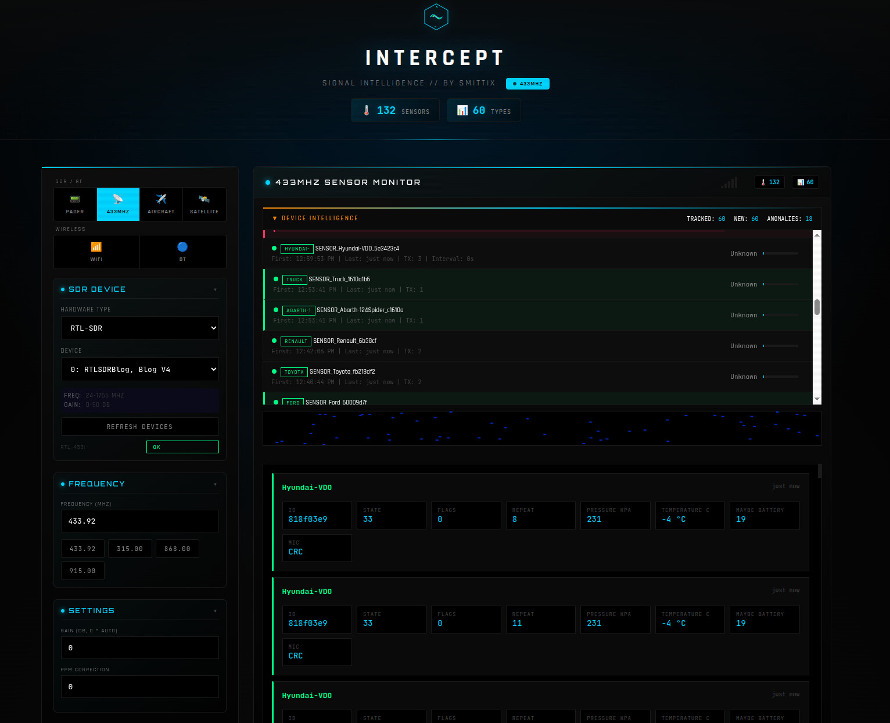
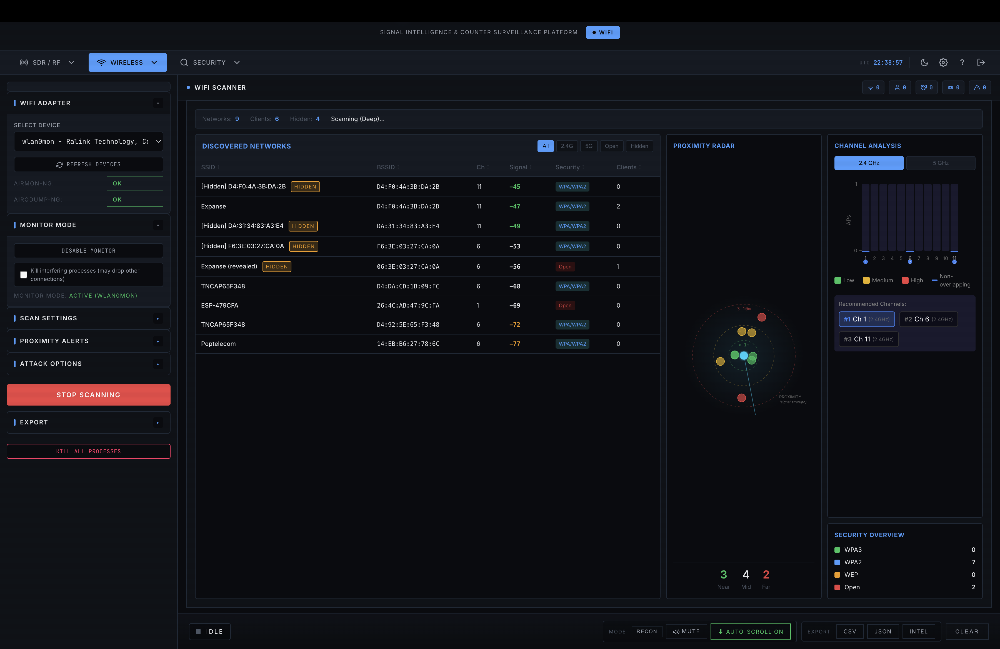
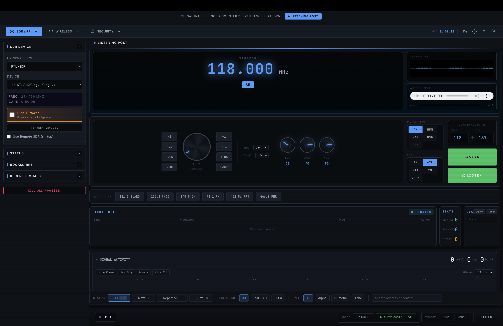
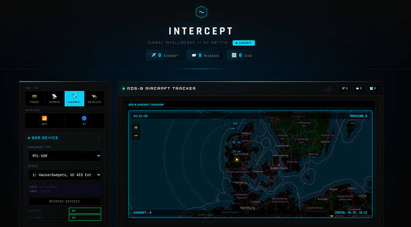
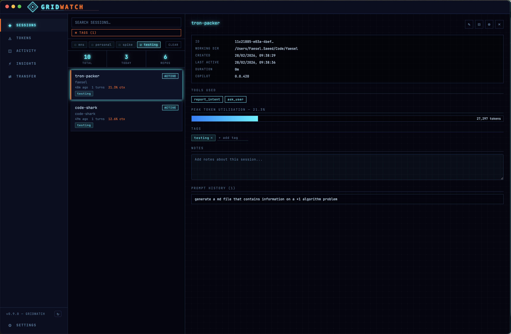
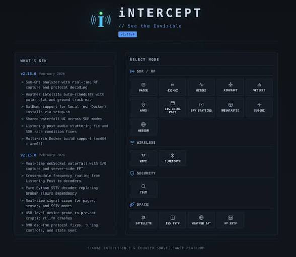

# INTERCEPT: Signal Intelligence & Counter Surveillance Platform

[](https://github.com/)
[](https://github.com/)
[](https://github.com/)

**INTERCEPT** is an advanced, modular Signal Intelligence (SIGINT) and Counter-Surveillance platform designed for comprehensive RF monitoring, wireless penetration testing, SDR analysis, and aerospace tracking. Built with a sleek, dark-themed tactical UI, it provides real-time monitoring and decoding capabilities across multiple frequencies, protocols, and spatial domains.

---

## 🚀 Key Features & Modules

### 1. SDR / RF Intelligence (`433MHz` & Sub-GHz Monitoring)
* **Real-time RF Capture & Protocol Decoding:** Monitor sensor frequencies (e.g., 433.92 MHz) to intercept remote telemetry, vehicle transponders, and smart device signals.
* **Device Intelligence & Anomaly Tracking:** Tracks active transponders, states, flags, repeats, pressure, and battery levels.
* **Sub-GHz Analyzer:** Advanced signal scope for pagers, sensors, and custom RF data.



### 2. Advanced Wireless Pentesting (Wi-Fi & Bluetooth)
* **Comprehensive Wi-Fi Scanner:** Discover networks (2.4GHz / 5GHz), SSIDs, BSSIDs, channels, signal strengths, encryption protocols (WPA3, WPA2, WEP, Open), and connected clients.
* **Proximity Radar & Channel Analysis:** Visualizes target distribution via an interactive tactical radar map and real-time channel occupancy charts.
* **Monitor Mode & Attack Vectors:** Seamlessly toggle interface monitor modes for packet analysis and active assessment.



### 3. Listening Post & Audio Signal Routing
* **Frequency Tuning & Demodulation:** Tune into precise audio and communication bands (e.g., 118.000 MHz aviation bands) with AM, NFM, WFM, USB, and LSB modes.
* **Real-time Waterfall UI & Audio Controls:** Live signal spectrograph with adjustable squelch, gain, filtering, and built-in recording/listening capabilities.



### 4. Aerospace Tracking (ADS-B Aircraft Tracker)
* **ADS-B & Satellite Monitoring:** Real-time tracking of aircraft, flight IDs, coordinates, and metadata plotted directly on an integrated tactical map.
* **Live Message Interception:** Decodes live telemetry packets from nearby aircraft and ground stations.



### 5. Dashboard & Session Management
* **GridWatch Integration:** Track active AI sessions, token utilization, working directories, tool intents, and prompt history in a unified command center.



---

## 🛠️ System Overview & Dashboard Interface

Here is a quick look at the main platform layout, mode selection, and recent changelogs (v2.16.0):



---

## 📦 What's New in v2.16.0
* **Sub-GHz Analyzer:** Real-time RF capture and protocol decoding.
* **Weather Satellite Auto-Scheduler:** Polar plot and ground track map integration.
* **SatBump Support:** Local (non-Docker) installations supported via `setup.sh`.
* **Multi-arch Docker Support:** Native support for both `amd64` and `arm64`.

---

## ⚙️ Installation & Quick Start

```bash
# Clone the repository
git clone https://github.com/your-username/intercept.git
cd intercept

# Run the automated setup script
chmod +x setup.sh
./setup.sh
```

---
*Developed for advanced security research, wireless penetration testing, and SIGINT analysis.*
